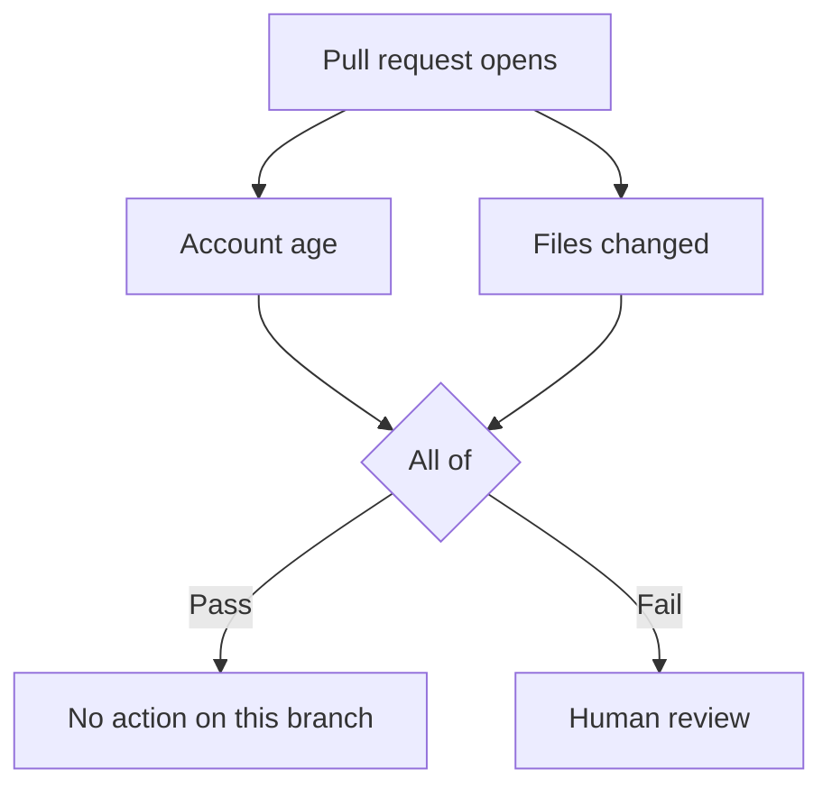

A trigger decides when a workflow runs. A check evaluates one condition. A gate combines results. An action runs when an incoming connection matches the outcome.

<Card title="Edit workflows with the CLI" href="/cli" icon="terminal" arrow>
  Pull a workflow into your checkout, validate your changes, and submit them for review.
</Card>

## Read the canvas

Open **Workflows** and select a workflow. Read the connections from the trigger toward the actions. Select a step to see its settings in **Properties**.

<Frame caption="This workflow checks account age on new or updated change requests. The failure connection leads to Block.">
  
</Frame>

Select **Save workflow** after editing. If the workflow is off, select **Turn on workflow** when you’re ready for it to act on live events.

## Combine checks with gates

To require an account at least 30 days old and no more than 100 changed files, connect both checks to an **All of** gate. Connect its failure output to **Human review**.

If either check fails, a maintainer gets an item in Human review. With **Any of**, this workflow sends the item only when both checks fail.

| Gate | Passes when |
| --- | --- |
| All of | Every connected check passes. The editor’s “If any of these rules fail” group uses this logic. |
| Any of | At least one connected check passes. |
| Not | Its single input fails. |

A check can be skipped when Tripwire cannot get the evidence it needs. A skipped result carries no pass or fail signal. All of can still fail on a known failure, and Any of can still pass on a known success. If the remaining evidence cannot decide the gate, the gate is skipped and neither branch runs from it.

### Add an exception

Use **Skip when** to add an exception to a group of requirements. For example, require a minimum account age unless the author already has a merged pull request in another person’s repository. A passing exception waives the requirement. If Tripwire cannot verify the exception, the requirement still applies.

The [TypeScript SDK guide](/typescript-sdk#combine-checks) shows the same workflow in code.

## Choose the action

| Action | Result |
| --- | --- |
| Block | Fails the Tripwire check and requests changes. The pull request stays open. |
| Close | Closes the issue or pull request. |
| Human review | Pauses the run for a maintainer decision in Tripwire. Approval and denial can lead to different next steps. |
| Request GitHub review | Asks selected users or teams to review in GitHub. |
| Note only | Leaves the check green and adds a note to the verdict comment. |
| Webhook or Discord | Sends the verdict to a destination you configure. |

## Run on a schedule

Use **On a schedule** for recurring maintenance. For example, run daily and lock closed issues that have been inactive for 30 days. Set the subject to issues, the state to closed, and the inactivity threshold to 30 days. Leave the filter for already locked conversations on. Use excluded labels to leave designated issues alone.

## Inspect a run

Open **Activity** and select a run to see the check results, the branch Tripwire took, and the recorded actions. If the run is paused, decide it in [Human review](/human-review).

<Frame caption="The run records the rule that failed, the evidence, and what Tripwire did next.">
  
</Frame>
