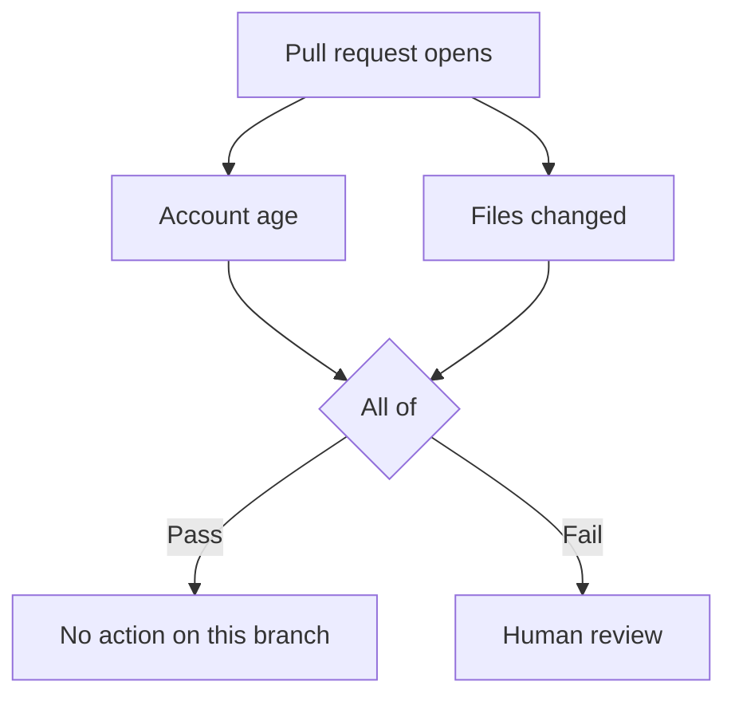

A **workflow** combines rules into a response to a repository event or schedule. Its **trigger** determines when it runs. Rules evaluate conditions, gates combine their results, and actions respond to those results. [Workflow terms](/concepts).

## Workflow canvas

The **canvas** shows how steps connect, from the trigger to the actions. **Properties** contains the settings for each step.

<Frame caption="This workflow checks account age on new or updated change requests. The failure connection leads to Block.">
  
</Frame>

<Callout type="tip">
  **Save workflow** keeps changes made on the canvas.
</Callout>

## Gate logic

This workflow requires an account at least 30 days old and no more than 100 changed files. An **All of** gate combines the two checks. Its failure branch leads to **Human review**.

If either check fails, a maintainer gets an item in Human review. With **Any of**, this workflow sends the item only when both checks fail.

| Gate | Passes when |
| --- | --- |
| All of | Every connected check passes. The editor’s “If any of these rules fail” group uses this logic. |
| Any of | At least one connected check passes. |
| Not | Its single input fails. |

A check can be skipped when Tripwire cannot get the evidence it needs. A skipped check supplies neither a pass nor a fail to the gate. All of can still fail on a known failure, and Any of can still pass on a known success. If the remaining evidence cannot decide the gate, the gate is skipped and neither branch runs from it.

### Exceptions

**Skip when** adds an exception to a group of requirements. For example, a minimum account age can apply unless the author already has a merged pull request in another person’s repository. A passing exception waives the requirement. If Tripwire cannot verify the exception, the requirement still applies.

The [TypeScript SDK guide](/typescript-sdk#combine-checks) shows the same workflow in code.

## Actions

| Action | Result |
| --- | --- |
| Block | Fails the Tripwire check and requests changes. The pull request stays open. |
| Close | Closes the issue or pull request. |
| Human review | Pauses the run for a maintainer decision in Tripwire. Approval and denial can lead to different next steps. |
| Request GitHub review | Asks selected users or teams to review in GitHub. |
| Note only | Leaves the check green and adds a note to the verdict comment. |
| Webhook or Discord | Sends the verdict to a destination you configure. |

## Scheduled workflows

**On a schedule** runs a workflow at regular intervals. A daily workflow could lock closed issues after 30 days of inactivity, excluding issues with a specified label and conversations that are already locked.

## Run history

Each run in **Activity** shows the check results, the branch Tripwire followed, and the actions it took. Paused runs wait in **Human review**.

<Frame caption="The run records the rule that failed, the evidence, and what Tripwire did next.">
  
</Frame>

## Editing with an agent

A coding agent can fetch, validate, and propose a workflow change through **MCP**. When working in a checkout, the **CLI** can pull workflows as TypeScript, compare local edits with the saved workflow, and submit them for review.

<CardGroup cols={2}>
  <Card title="MCP setup" href="/ai-tools" icon="bot" arrow>
    Connect a coding agent to Tripwire.
  </Card>
  <Card title="Workflow commands" href="/cli#edit-a-workflow" icon="terminal" arrow>
    Pull, validate, compare, and push workflow files.
  </Card>
</CardGroup>
